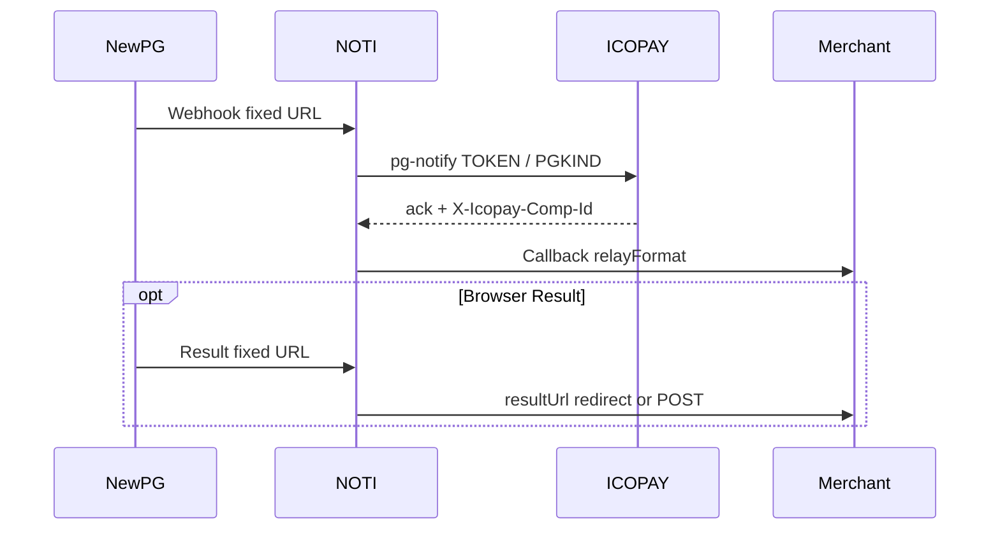

# ICOPAY · 신규 결제대행사(PG) NOTI 연동 — 요청 기준안

| 항목 | 내용 |
|------|------|
| **문서 버전** | 1.0 |
| **작성일** | 2026-10-31 |
| **용도** | 신규 PG를 추가할 때마다 **ICOPAY에 일괄 요청하는 표준 요구사항** |
| **관련 시스템** | ICOPAY(전산·결제 생성) + NOTI(노티 미들웨어) + 가맹점 Callback/Result |
| **운영 NOTI** | https://noti.icopay.net |
| **참고 구현** | ElementPay / OXPAY / OMSPAY / QXIPAY / ILKPAY / CRYPTO / QBANG / JPAY |

> 이 문서는 **복사해서 PG명만 바꿔** ICOPAY·NOTI 양쪽에 그대로 전달하는 기준안입니다.  
> 아래 **「매 건 기입 템플릿」** 을 채운 뒤, 본문 체크리스트를 함께 첨부하세요.

---

## 0. 역할 분담 (반드시 합의)

| 구간 | 담당 | 설명 |
|------|------|------|
| 결제 생성·승인·정산 원장 | **ICOPAY** | PG API 호출, 주문·Comp-Id 매핑, 전산 적재 |
| PG → 본사 Webhook/Result **고정 입구** | **NOTI** | 가맹별 URL이 없는 PG는 본사 1 URL만 등록 |
| 가맹 Callback / Result 통보 | **NOTI** | `relayFormat`(일반/JSON/FORM), 재전송, 로그 |
| 전산(내부) 노티 | **NOTI → ICOPAY 전산 URL** | 가맹 `enableInternal` / 전산대상 설정 |
| 가맹점 등록(Comp-Id·Callback·Result) | **ICOPAY Provision → NOTI** | NOTI `merchants`에 저장 |

**원칙**

1. PG 캐비닛에 **가맹별 Webhook을 넣을 수 없으면**, 가맹 통보 주체는 항상 **NOTI**.
2. ICOPAY는 NOTI 가맹 식별을 위해 **Comp-Id(또는 동등 키)를 반드시 제공**.
3. NOTI는 PG 응답 본문을 ICOPAY/PG 규약상 **변환 금지**가 명시된 구간은 패스스루.



---

## 1. 매 건 기입 템플릿 (요청 시 필수 기입)

ICOPAY에 보낼 때 **이 표부터** 채웁니다.

| # | 항목 | 기입란 |
|---|------|--------|
| 1 | PG 공식명 / 내부 코드명 | 예: `OMSPAY` / `omspay` |
| 2 | NOTI `pgKind` / `merchantPgKind` (영문 소문자) | 예: `omspay` |
| 3 | ICOPAY `pg-notify` path 세그먼트 | 예: `…/pg-notify/{token}/OMSPAY` |
| 4 | 연동 유형 | □ 고정 Webhook 1개(본사) □ 가맹별 URL(슬롯) □ ICOPAY 폴링 미러 |
| 5 | 서버→서버 통보 | □ Webhook/Notify □ 없음(폴링만) |
| 6 | 브라우저 Result | □ 있음(GET/POST) □ 없음 |
| 7 | 서명/인증 | 헤더명·알고리즘·검증 주체(ICOPAY/NOTI) |
| 8 | 주문번호 필드명 | 예: `order` / `orderid` / `SO-…` |
| 9 | 거래번호 필드명 | 예: `transaction_id` / `id` / `so` |
| 10 | 금액·통화 필드 | 예: `amount`, `currency` (소수/정수·100배 여부) |
| 11 | 성공 판정 규칙 | 예: `returncode=00`, `PaymentStatus=Succeeded` |
| 12 | Comp-Id 전달 방식 | □ notify 응답 헤더 `X-Icopay-Comp-Id` □ order-lookup □ 본문 필드 |
| 13 | 목표 오픈일 / 샌드박스 여부 | |
| 14 | 담당자 (ICOPAY / NOTI / PG) | |

---

## 2. ICOPAY 개발·제공 필수 항목

### 2.1 PG 연동(결제·콜백 수신)

| # | 요구 | 세부 | 완료 |
|---|------|------|------|
| I-1 | PG 공식 API·Webhook 스펙 | 요청/응답 샘플, 서명, 재시도 정책 | □ |
| I-2 | 샌드박스·라이브 키/MID | NOTI·ICOPAY 각각 어디 쓰는지 명시 | □ |
| I-3 | 결제 생성 시 주문번호 규칙 | NOTI/가맹이 추적 가능한 **단일 주문키** (가능하면 SO 또는 가맹 order) | □ |
| I-4 | 승인/실패/취소 상태 코드표 | NOTI `isSuccessPaymentBody` / 거래내역 필터와 매핑 | □ |
| I-5 | (해당 시) 무효·환불 API | ChillPay류만 해당. 없으면 「지원 안 함」 명시 | □ |

### 2.2 NOTI ↔ ICOPAY Notify Ingress

고정 Webhook형 PG는 아래가 **필수**입니다.

| # | 요구 | 세부 | 완료 |
|---|------|------|------|
| I-6 | `POST …/pg-notify/{ingressToken}/{PGKIND}` | PGKIND는 대문자 관례(예: `OMSPAY`, `ELEMENTPAY`) | □ |
| I-7 | 수신 Content-Type | JSON / form — PG 원문과 동일하게 받을 것 | □ |
| I-8 | 서명 헤더 패스스루 | 예: `x-waylar-signature` — NOTI가 ICOPAY로 그대로 전달 | □ |
| I-9 | **응답 헤더 `X-Icopay-Comp-Id`** | 가맹 식별용. **누락 시 NOTI는 가맹 통보 실패** | □ |
| I-10 | (권장) `X-Icopay-Order-No` | 주문키 정규화용 | □ |
| I-11 | (권장) `X-Icopay-Notify-Delivery: LIVE\|RETRY` | 재시도 구분 | □ |
| I-12 | check/pay 등 **본문 변환 금지** 구간 | EP처럼 PG에 그대로 돌려줘야 하면 문서에 명시 | □ |
| I-13 | HTTP 성공 범위 | 2xx만 성공인지, 202 허용인지 | □ |

**Comp-Id 규칙**

- 값은 ICOPAY 가맹 **Comp-Id / merchantId** 와 동일 문자열.
- NOTI merchant 키는 `{compId}` 또는 `{compId}#{pgKind}` (예: `6000000058#omspay`).
- **이름(compName)** 도 Provision/`icopayMeta`에 넣어 NOTI 목록에 `이름 (Comp-Id)` 로 표시되게 할 것.

### 2.3 Order Lookup (Comp-Id 폴백) — **강력 권장**

Webhook 응답에 Comp-Id가 없거나, Result만 오고 Comp-Id가 비는 경우가 있습니다.

| # | 요구 | 세부 | 완료 |
|---|------|------|------|
| I-14 | `GET …/order-lookup?order={order}` | NOTI ingress 설정의 `icopayOrderLookupUrl` | □ |
| I-15 | 조회 키 우선순위 | **SO / 가맹주문번호 우선**. charge id(`ch_…`)만으로는 NOT_FOUND 되는 PG 다수 | □ |
| I-16 | 응답 | JSON에 `compId`(+ `compName` 권장) 또는 헤더 `X-Icopay-Comp-Id` | □ |
| I-17 | 미존재 | 명확한 NOT_FOUND / 404 — NOTI가 로그에 남김 | □ |

### 2.4 가맹 Provision API (신규등록)

NOTI 「가맹점 신규등록 → {PG}」와 맞춥니다.

| # | 요구 | 세부 | 완료 |
|---|------|------|------|
| I-18 | `POST /api/v1/icopay/merchants/provision` | `pgKind: "{pgKind}"` | □ |
| I-19 | 필수 바디 | `merchantId`(Comp-Id), `callbackUrl`, `resultUrl`(Result 있는 경우), `internalTargetId` | □ |
| I-20 | `options` | `enableRelay`, `enableInternal`, `enableDevInternal`, **`relayFormat`**: `raw`\|`json`\|`form` | □ |
| I-21 | `icopayMeta` | `compId`, **`compName`(가맹명)** — UI 표시용 **필수에 가깝게** | □ |
| I-22 | GET/PUT/DELETE | `?pgKind={pgKind}` | □ |
| I-23 | 고정 ingress형 | 슬롯번호(`jpaySlotNo` 등) **불필요** — EP/OMSPAY와 동일 | □ |
| I-24 | JPAY형(슬롯) | 슬롯·가맹별 notify URL 발급 규칙을 별도 명시 | □ |

참고 문서: `docs/ICOPAY_Provision_API_ElementPay.md`, `docs/ICOPAY_Provision_API_ox.md`, `docs/ICOPAY_Provision_API_JPAY_v0.1.md`

### 2.5 전산·개발 노티 / 종합거래

| # | 요구 | 세부 | 완료 |
|---|------|------|------|
| I-25 | 전산 수신 URL | 전산대상별 Callback/Result URL — NOTI `enableInternal` | □ |
| I-26 | 개발 전산 URL | 동일 구조 `enableDevInternal` | □ |
| I-27 | 금액·통화 규칙 | ICOPAY 금액 표시(/100 등) PG별 설정과 일치 | □ |
| I-28 | 종합거래(노티거래내역) | 해당 PG 탭에서 **동일 TransactionId·가맹명·상태**로 조회 가능해야 함 | □ |
| I-29 | PG 소스 필터 | NOTI `source={pgKind}` / ICOPAY 측 동일 코드명 | □ |

---

## 3. NOTI 측 구현 범위 (ICOPAY 요청에 명시해 둘 항목)

ICOPAY가 “NOTI도 같이 열어 달라”고 할 때 NOTI가 준비하는 목록입니다.

| # | 항목 | 내용 | 완료 |
|---|------|------|------|
| N-1 | Ingress URL | `POST /noti/{pgKind}`, `GET\|POST /noti/result/{pgKind}` | □ |
| N-2 | Ingress config | `config/{pgKind}-ingress.json` (`icopayNotifyUrl`, `icopayOrderLookupUrl`) | □ |
| N-3 | 가맹 등록 UI | 신규등록 메뉴 + `merchantPgKind` | □ |
| N-4 | 로그분석 탭 | PG 소스 필터, Comp-Id·가맹명 표시, 재전송(일반/JSON/FORM) | □ |
| N-5 | 피지결과 / 전산·개발 로그 | 동일 `source` | □ |
| N-6 | 노티거래내역(종합거래) | 탭·필터·가맹명(`이름 (Comp-Id)`) | □ |
| N-7 | 취소/무효/환불 목록 | PG가 지원하면 연동, 아니면 탭만·API 없음 명시 | □ |
| N-8 | 다국어 | ko/ja/en/th/zh 라벨·힌트 | □ |
| N-9 | 가맹 통보 본문 매핑 | PG 원문 → 가맹이 받는 필드(EPS/JPAY 유사 시 명시) | □ |
| N-10 | Result 브라우저 | 쿼리/폼 전달 방식, 세션 없어도 동작(EPS형) | □ |

---

## 4. 가맹 통보(Callback) 계약

### 4.1 형식

| relayFormat | Content-Type | 비고 |
|-------------|--------------|------|
| `raw` | 수신 원문과 동일 | 가능하면 원문 |
| `json` | `application/json` | OMSPAY 등 매핑 바디 |
| `form` | `application/x-www-form-urlencoded` | |

가맹마다 수신 가능 형식이 다르므로 **Provision `options.relayFormat` 필수**.  
NOTI 로그분석 재전송은 **일반(=가맹 설정 형식) / JSON / FORM** 3종.

### 4.2 본문에 넣을 권장 필드 (가맹·전산 공통 최소)

| 필드 | 설명 |
|------|------|
| 주문/거래 ID | `orderid` / `OrderNo` / `transaction_id` / `so` 중 PG에 맞게 **중복 키 허용** |
| 금액·통화 | `amount`, `currency` |
| 상태 | 성공/실패 코드 + 텍스트 |
| **Comp-Id** | `compId` / `CompId` / `Comp-Id` / `merchantId` — **반드시 스탬프** |
| 시각 | 결제·통보 시각 (타임존 명시) |

### 4.3 Result (브라우저)

| # | 요구 | 완료 |
|---|------|------|
| R-1 | 고정 Result URL을 PG/캐비닛에 등록 (가맹 Result URL 등록 금지인 경우) | □ |
| R-2 | NOTI가 가맹 `resultUrl`로 302 또는 POST (기존 `resultDeliveryMode`) | □ |
| R-3 | Comp-Id·주문번호 쿼리/바디에 포함 (가맹 세션 없이도 복귀 가능하도록) | □ |
| R-4 | 실패/취소 Result도 동일 경로 | □ |

---

## 5. 운영·보안

| # | 요구 | 완료 |
|---|------|------|
| S-1 | Ingress Token / API Key 분리 (샌드박스·라이브) | □ |
| S-2 | IP allowlist (PG→NOTI 또는 NOTI→ICOPAY) 필요 여부 | □ |
| S-3 | 서명 검증 주체: **ICOPAY에서 검증** 권장 (NOTI는 헤더 패스스루) | □ |
| S-4 | 로그에 카드번호·비밀번호 등 민감정보 마스킹 규칙 | □ |
| S-5 | 재시도: PG·ICOPAY·NOTI 각각 몇 회·간격 | □ |
| S-6 | `config/`·시크릿은 운영에 함부로 덮어쓰지 않음 (NOTI 배포 규칙) | □ |

---

## 6. 인수 테스트 (오픈 전 필수)

| # | 시나리오 | 기대 | 완료 |
|---|----------|------|------|
| T-1 | 샌드박스 결제 성공 Webhook | ICOPAY 2xx + `X-Icopay-Comp-Id` → NOTI 가맹 Callback 성공 | □ |
| T-2 | Comp-Id 헤더 누락 | order-lookup으로 Comp-Id 복구 **또는** 로그에 Missing Comp-Id + 수동 지정 재전송 | □ |
| T-3 | order-lookup을 SO로 조회 | `compId`·가맹명 반환 | □ |
| T-4 | charge/`ch_` 만으로 lookup | NOT_FOUND여도 SO로는 성공해야 함 (문서화) | □ |
| T-5 | 가맹 Callback 404 | NOTI 로그 `HTTP 404` — **가맹 URL 문제**로 구분 | □ |
| T-6 | 재전송 일반/JSON/FORM | 가맹 `relayFormat` 권장 버튼 강조, 각각 전송 | □ |
| T-7 | Result 브라우저 | 가맹 result 페이지 도달, Comp-Id·주문 표시 | □ |
| T-8 | 노티거래내역 탭 | 가맹명 `이름 (Comp-Id)`, TransactionId, 상태 | □ |
| T-9 | 로그분석 JSON 셀 | 요약 3줄 + 더블클릭 펼침 | □ |
| T-10 | Provision | ICOPAY 등록 → NOTI 가맹 목록·Callback 반영 | □ |
| T-11 | 실패·취소 통보 | 상태 필터·취소 목록 동작 | □ |
| T-12 | 라이브 1건 E2E | 실가맹 또는 합의된 테스트 가맹 | □ |

---

## 7. ICOPAY에 보낼 요청 문장 예시 (복사용)

```text
[신규 PG 연동 요청] {PG_NAME} ({pgKind})

ICOPAY·NOTI 양쪽에 아래 기준안(docs/ICOPAY_신규결제대행사_NOTI연동_요청기준안.md) 적용을 요청합니다.

1) ICOPAY
- pg-notify …/{PGKIND} 수신 및 서명 검증
- 모든 notify 응답에 X-Icopay-Comp-Id (+ 가능하면 Order-No, compName)
- order-lookup?order={order} (SO/가맹주문 우선 매칭)
- merchants/provision pgKind={pgKind} (callbackUrl, resultUrl, relayFormat, icopayMeta.compName)
- 전산/개발 노티·종합거래에서 해당 PG 식별 코드 통일

2) NOTI
- /noti/{pgKind}, /noti/result/{pgKind} 고정 입구
- 가맹 등록·로그·거래내역·재전송(일반/JSON/FORM)
- Comp-Id 기반 가맹명 표시 및 가맹 Callback/Result 릴레이

3) 일정·샌드박스 키·샘플 payload·성공/실패 코드표 첨부

첨부: 본 기준안 + PG 공식 스펙 + 샘플 Webhook/Result body
```

---

## 8. PG 유형별 빠른 분기

| 유형 | 예 | ICOPAY 핵심 | NOTI 핵심 |
|------|----|-------------|-----------|
| **고정 Webhook 1개** | EP, OX, OMSPAY, QXI, ILK | Comp-Id 헤더 + order-lookup + provision | 고정 ingress + 가맹 릴레이 |
| **가맹별 notify URL** | JPAY(슬롯) | 슬롯·URL 발급 | `/noti/callback/jN` |
| **ICOPAY 폴링 미러** | QBANG, CRYPTO | ICOPAY가 NOTI로 확정 이벤트 POST | `/noti/{pg}` 미러 수신만 |

새 PG가 어느 유형인지 **섹션 1 템플릿 4번**에서 먼저 고르면, 불필요한 슬롯/캐비닛 요구를 줄일 수 있습니다.

---

## 9. 체크리스트 요약 (인쇄용)

**ICOPAY:** I-1…I-29  
**NOTI:** N-1…N-10  
**Result:** R-1…R-4  
**보안:** S-1…S-6  
**테스트:** T-1…T-12  

오픈 조건: **I-9(Comp-Id) + I-18~21(Provision+가맹명) + T-1 + T-8 + T-12** 는 최소 필수.

---

## 10. 변경 이력

| 버전 | 일자 | 내용 |
|------|------|------|
| 1.0 | 2026-10-31 | 초안 — OMSPAY/EP 운영 이슈(Comp-Id·order-lookup·가맹명·재전송 형식) 반영 |
